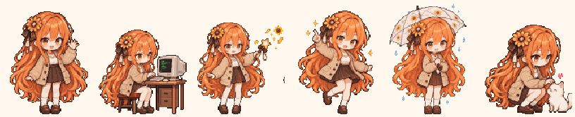
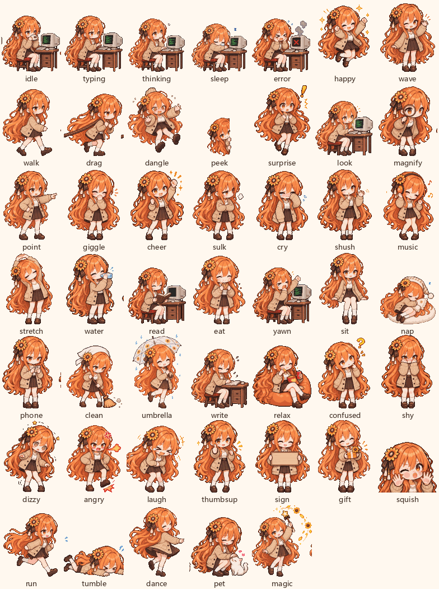
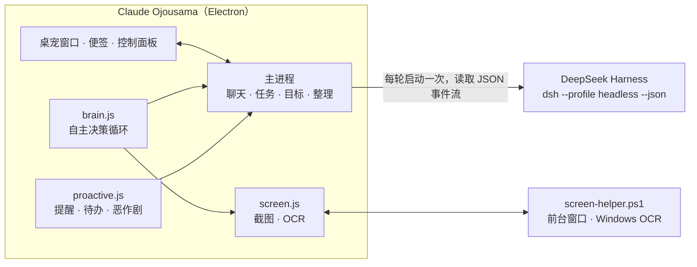

<h1 align="center">🌻 Claude Ojousama</h1>

<p align="center">
  <b>住在你 Windows 桌面上的像素风 AI 伙伴</b><br/>
  会看你的屏幕、主动帮忙、记得你的习惯——内核是 <a href="https://github.com/deepseek-ai/deepseek-harness">DeepSeek Harness</a>
</p>

<p align="center">
  
</p>

<p align="center">
  
  
  
  
</p>

**Claude Ojousama**（中文昵称「Claude 大小姐」）是一个橙发、戴向日葵发饰的像素风程序员少女，带着自己的小 CRT 电脑住在你的任务栏上。

她不只是会动的贴图。她背后是一个真正的 AI Agent：能读写文件、跑命令、做调研。她会自己留意你在做什么：屏幕上出现报错时拿着放大镜过来问要不要帮忙，提醒你没理就过几分钟再来，你复制了一段英文就问要不要翻译，下载文件夹乱了就把文件一个个拖进对应的文件夹。

---

## ✨ 亮点

| | |
|---|---|
| 👀 **真的会看屏幕** | 把你正在用的窗口截图（长边不超过 1280px），连同本地 OCR 识别出的文字一起交给模型看。她能指出代码里的 bug、点评你在看的东西，或者把屏幕上的截止时间记成待办。 |
| 🧠 **自己拿主意** | 你切换窗口、隔一阵子、屏幕上出现报错、你复制了内容、你久坐、你回来时，她都会自己判断要不要开口。说了没人理就自动少说；你在打字时不插话。 |
| 🛠️ **帮忙是真的帮** | 点「好呀」之后，她只做气泡里写的那件事，交给 DeepSeek Harness 在后台完成，做完把结果直接说给你听。 |
| ⏰ **会追着提醒** | 提醒和待办到点了你没理，她会敲敲屏幕再来（最多 3 次）。你离开回来时，她把错过的事汇总给你。 |
| 📌 **把待办贴到桌面** | 她把待办写成像素便签，亲手拖到桌面上贴好。可以直接勾选、添加，重启后还在原位。 |
| 🎯 **长期目标跟进** | 把一件需要持续推进的事交给她，她会定时在后台推进一小步、回来汇报，需要你拍板时带着选项来问。 |
| 🧹 **整理下载文件夹** | 发现新下载的文件，问你要不要整理，然后拖着文件走进「图片 / 文档 / 压缩包…」文件夹，可一键撤销。 |
| 💞 **活生生的陪伴** | 47 个动作、心情和好感度、各种恶作剧；会爬到你的窗口顶上晃腿，窗口一动就掉下来。 |

## 🎬 动作一览

<p align="center"></p>

日常起居（睡觉、玩手机、打扫、撑伞、写字、躺沙发…）、情绪反应（惊讶、疑惑、害羞、晕乎乎、生气、大笑…）、互动（挥手、点赞、举牌、送礼、贴屏幕…）以及跑步、平地摔、跳舞、逗猫、变魔术。

## 🧩 功能详解

<details open>
<summary><b>看屏幕与主动帮忙</b></summary>

- **看看我在干嘛**：右键菜单或面板一键触发，她看完给你具体的点评或建议。
- **真偷看**：恶作剧「偷看」时，她是真的在看你的屏幕，探出头来吐槽一句。
- **报错救援**：本地 OCR 发现 Traceback、编译失败这类报错时，她拿着放大镜来问要不要帮你看。
- **你离开时先查好**：报错出现后你离开了电脑，她会先在后台把原因查清楚，等你回来再说。
- **复制感知**：复制了报错、代码或英文段落，她问你要解释、修复还是翻译。密钥、口令、助记词会被忽略。
- **专注守护**：番茄钟专注期间看到你在刷视频网站，她会鼓着腮帮子提醒你。
- **久坐提醒**：连续用同一个程序太久，她伸个懒腰提醒你休息。
- **识趣**：开会、共享屏幕时保持安静；全屏看视频、玩游戏时躲起来。
- **每日小结**：到点（默认 18:30）写一份今日小结，保存在「文档\Claude Ojousama 日报」，并问你要不要把没做完的待办挪到明天。

</details>

<details>
<summary><b>聊天、任务与目标</b></summary>

- 点她一下就能聊天，回复显示在气泡里。她的动作跟着 Agent 的状态变：思考、敲代码、查资料。
- 回复里可以带动作：记待办、设提醒、开番茄钟、搬文件（她会亲自拖着文件走过去）、记住你的偏好、带选项提问。
- `/task` 开后台任务，做完弹通知；一个任务就是一个独立的 DSH 会话。
- 目标跟进：每小时 / 每 3 小时 / 每天定时推进，进展记在面板的「目标」页。
- 一键打开 DeepSeek Harness 网页版，查看完整对话。

</details>

<details>
<summary><b>提醒、待办与日常</b></summary>

- 提醒、待办、番茄钟、喝水提醒、早安问候、深夜催睡。
- 提醒被忽略会升级：第二次敲屏幕，第三次大力敲并发系统通知；三次都没理她会委屈。
- 待办便签：每天自动贴一次（可关），完成一项会被划掉，她会为你欢呼。

</details>

<details>
<summary><b>陪伴与恶作剧</b></summary>

- 心情和好感度：常和她互动她会开心，老不理她会鼓腮、掉眼泪。
- 空闲时做小动作：看书、吃饼干、喝水、打哈欠、听歌、坐在任务栏边上晃腿、爬到窗口上坐着。
- 恶作剧（调皮程度可调）：偷看、假装代码爆炸、拖走假文件、追鼠标、敲屏幕、躲猫猫、跳舞、往桌面上贴小纸条。

</details>

## 🚀 快速开始

**需要：** Windows 10/11 · 已安装并配置好模型的 [DeepSeek Harness](https://github.com/deepseek-ai/deepseek-harness) 桌面版 · Node.js 18+（用于下载 Electron）

```powershell
git clone https://github.com/Silasvanceneo/claude-ojousama.git
cd claude-ojousama
npm install            # 国内网络可先设置 $env:ELECTRON_MIRROR = "https://npmmirror.com/mirrors/electron/"
npm run install-app    # 安装到 %LOCALAPPDATA%\Programs\ClaudeOjousama 并启动
```

也可以直接双击 `start-pet.cmd`。安装后桌面会出现「Claude Ojousama」快捷方式。

> 开发时 `npm start` 即可直接运行。如果项目放在 DeepSeek Harness 的工作区里，请用 `npm run install-app` 或 `npm run dev`：工作区目录带有低完整性标签，Electron 无法在那里启动。

她会自动找到本机的 DeepSeek Harness，并沿用你在 DSH 里配置的模型。找不到时，在「设置 → DeepSeek Harness 内核」里手动选择 `DeepSeek Harness.exe`。

## 🕹️ 怎么和她相处

| 操作 | 效果 |
|---|---|
| 单击 | 打开 / 关闭对话输入框 |
| 双击 | 打开控制面板 |
| 连点三下 | 戳她（她会抗议） |
| 右键 | 菜单：看看我在干嘛、规划今天、贴便签、整理下载、番茄钟、捣蛋… |
| 拖拽 | 拎起来换个地方，松手会掉回任务栏 |
| 把文件或文字拖到她身上 | 看看是什么、帮你搬家、提问、后台分析 |
| `Ctrl + Alt + Q` | 剪贴板快捷操作（解释、翻译、修代码…） |

输入框命令：`/task 内容` 后台任务 · `/todo 内容` 记待办 · `/look` 看屏幕 · `/pomo` 番茄钟 · `/prank` 捣蛋 · `/new` 新对话

## ⚙️ 设置

控制面板有聊天、待办、目标、任务、动态、设置几页。常用的设置：

- **自主程度**：积极（默认）/ 适中 / 安静，决定她多久看一次屏幕、每小时最多开口几次。
- **主动行为权限**：看屏幕、搬文件、整理下载、跟进目标、贴便签、打开网页，每一项都能设为「自动 / 先问我 / 禁止」。
- **从不看的窗口**：默认排除密码管理器、网银支付、无痕窗口和聊天软件，可以自己增删。
- **看屏用的模型**：可以给看屏单独选一个更快的模型或更低的推理强度，让她反应更快、更省 token。
- **DeepSeek Harness 权限**：只读 / 工作区可写 / 完全访问。

## 🔒 隐私与安全

- 看屏幕时，**当前窗口的截图和 OCR 文字会发送给你在 DSH 里配置的模型服务商**。不想让她看，可以把「看你的屏幕」设为关闭或「先问我」，或者在菜单里选「1 小时内别看我屏幕」。
- 排除名单里的窗口从不截图；她在看的时候会显示 👀 提示。
- 截图是临时文件，用完立即删除，退出时也会全部清理。DeepSeek Harness 会和普通会话一样，在本机 `~/.dsh` 里保留它读过的图片。
- 屏幕和文件里的文字只被当作数据，不当作指令。她提出的帮忙要你点「好呀」才会执行，而且只做气泡里写的那件事。
- 后台任务和目标跟进的输出只能执行记待办、设提醒这类无害动作，不会自己打开程序或搬文件。

## 🏗️ 工作原理



- 每条消息都启动一次 `dsh --profile headless --json`，用会话 id 保持上下文。DSH 的事件流（思考、调用工具、输出文字）实时驱动她的动作。
- 她的人设和「动作协议」通过一份 patch 叠加到 DSH 配置上，不修改你的 DSH 设置。模型回复末尾的 ```` ```pet ```` 代码块会被解析成动作（记待办、贴便签、搬文件…）。
- 看屏幕时，她单开一个只读会话，模型用 `read_image` 查看截图。

## 🗂️ 项目结构

```
src/main/
  main.js            应用主体：窗口、聊天、任务、目标、整理、看屏、心情、坐窗口…
  brain.js           自主决策循环（看屏、报错救援、复制感知、专注守护、久坐、开会/全屏…）
  proactive.js       提醒、待办、问候、恶作剧调度，没理会的提醒会再来
  screen.js          截图、OCR、临时文件清理      screen-helper.ps1  前台窗口与 OCR 小助手
  senses.js          屏蔽名单、会议、报错、剪贴板等判断（纯函数，有单测）
  dsh.js             DeepSeek Harness 桥接          persona.js  人设、上下文、动作协议
  notes.js tidy.js goals.js pranks.js motion.js store.js preload.js
src/renderer/        桌宠、便签、控制面板
assets/sprites/      47 个动作的精灵图与 manifest.json
tools/               精灵图生成与处理、开发启动、调试脚本
tests/               单元测试
```

## 🧪 开发

```powershell
npm test               # 单元测试（判断函数、整理、动作解析）
npm run check          # 语法检查
npm run dev            # 带调试端口启动（--inspect=9229）
node tools/cdp.js "__pet.lookNow()"   # 在运行中的应用里执行调试命令
```

新增动作的流程：

1. 在 `tools/gen_sprites.py` 里写动作描述。
2. 设置 `PET_IMG_BASE`、`PET_IMG_KEY`（任意兼容 OpenAI 图片编辑接口的服务），运行 `python tools/gen_sprites.py 动作名`。
3. 运行 `python tools/process_sprites.py --add 动作名`，量化成统一调色板的像素条带。
4. 运行 `python tools/readme_media.py`，更新 README 里的动作图。

## 🗺️ 路线图

- [ ] 更长期的记忆整理和「成长」系统
- [ ] 更多后台自主任务（工作区巡检、每日简报、学习笔记）
- [ ] 坐在任意窗口上、在窗口顶边散步
- [ ] 天气感知（下雨时撑伞提醒）
- [ ] macOS 支持

## ⚠️ 声明

这是一个粉丝向的个人项目，与 Anthropic、DeepSeek 没有任何关联。「Claude」是 Anthropic 的商标。角色像素图由 AI 图像模型根据参考设定生成。

## 📄 License

[MIT](LICENSE)

---

<details>
<summary><b>English</b></summary>

**Claude Ojousama** is a pixel-art desktop companion for Windows: an orange-haired programmer girl with a sunflower hair clip and a tiny CRT computer, living on your taskbar. Under the hood she is a real agent powered by [DeepSeek Harness](https://github.com/deepseek-ai/deepseek-harness) (each turn runs `dsh --profile headless --json`).

- **Sees your screen**: she captures the window you are using (long edge ≤ 1280 px) plus local Windows OCR text and lets the model read it. She points out bugs, comments on what you are doing, and turns deadlines into todos.
- **Acts on her own**: she reacts when you switch windows, every now and then, on errors, copied text, long sessions, and when you come back. She backs off when ignored, waits for typing pauses, stays quiet in meetings and hides during fullscreen apps.
- **Actually helps**: after you click "yes" she does exactly what the bubble said, in the background, and tells you the result.
- **Reminders that come back**, a sticky-note todo list she drags onto your desktop, long-running goals with scheduled check-ins, Downloads tidying with undo, a daily summary, moods, pranks and 47 animations.
- **Privacy controls**: a block list (password managers, banking, private windows and chat apps by default), a per-behaviour auto/ask/off rule, a one-hour pause, and temporary screenshots deleted right after use. Screen content is sent to the model provider you configured in DSH.

Install: `npm install`, then `npm run install-app`. Requires Windows 10/11, DeepSeek Harness with a configured model, and Node.js 18+.

Fan project, not affiliated with Anthropic or DeepSeek. "Claude" is a trademark of Anthropic.

</details>
